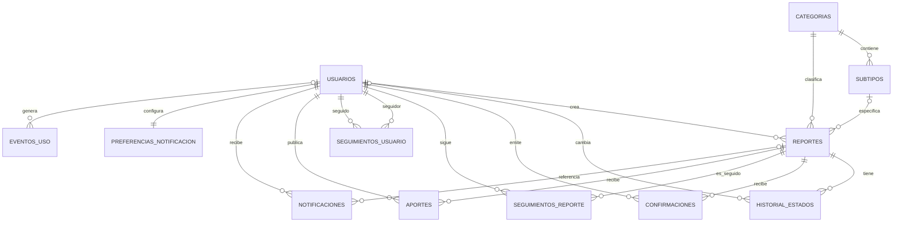

# Diagrama entidad-relación

`cache_geocodificacion` y `alertas_viales` son entidades independientes: la primera evita repetir consultas a Nominatim y la segunda conserva avisos viales publicados. La regla de no-autoseguimiento se valida en el servicio de seguimiento; MySQL 8 no permite esa comprobación `CHECK` junto con las dos claves foráneas autorreferentes.
